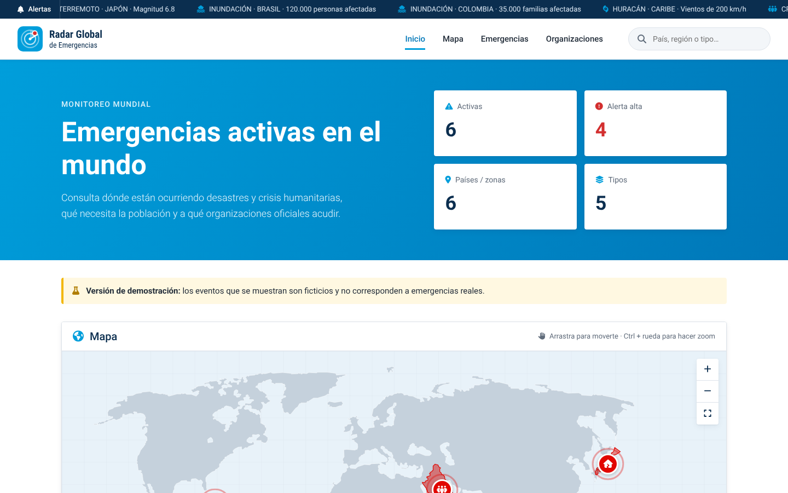
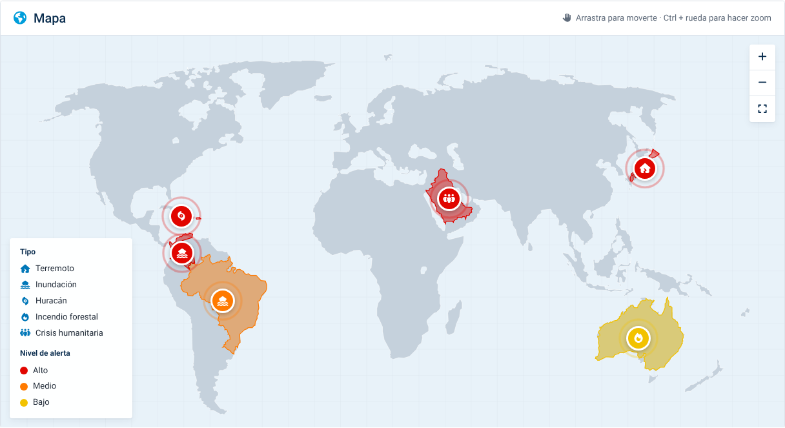
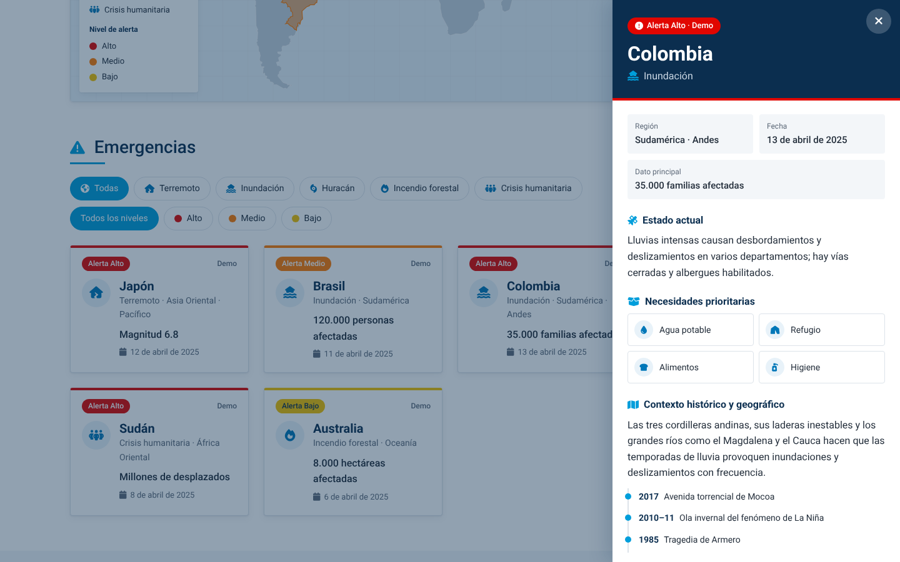
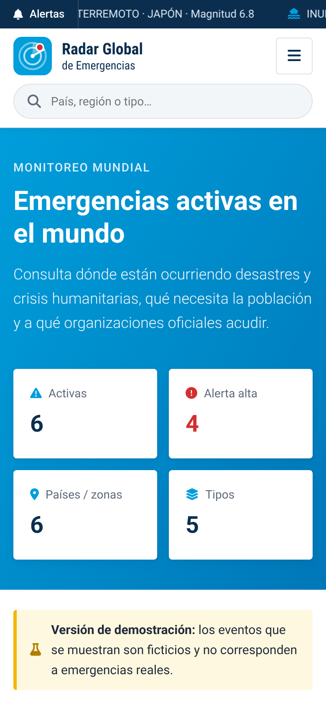

<div align="center">


# Radar Global de Emergencias

**Mapa interactivo para consultar emergencias en el mundo, qué necesita la población afectada y a qué organizaciones oficiales acudir.**




</div>

---

## Tabla de contenido

- [Descripción](#descripción)
- [Funcionalidades](#funcionalidades)
- [Capturas](#capturas)
- [Tecnologías](#tecnologías)
- [Cómo ejecutarlo](#cómo-ejecutarlo)
- [Estructura del proyecto](#estructura-del-proyecto)
- [Cómo funciona](#cómo-funciona)
- [Agregar una emergencia](#agregar-una-emergencia)
- [Accesibilidad y diseño adaptable](#accesibilidad-y-diseño-adaptable)
- [Posibles mejoras](#posibles-mejoras)
- [Créditos](#créditos)
- [Autor](#autor)

---

## Descripción

**Radar Global de Emergencias** es una página web que reúne en un solo lugar las emergencias activas en el mundo, como terremotos, inundaciones, huracanes, incendios forestales y crisis humanitarias. Cada emergencia tiene:

- su **nivel de alerta** (alto, medio o bajo),
- el **estado actual** de la situación,
- las **necesidades prioritarias** de la población,
- el **contexto histórico y geográfico** de la zona,
- y un enlace directo a **ayuda oficial**.

La plataforma **no recibe donaciones ni guarda datos bancarios**. Solo dirige a sitios oficiales como OCHA, la Cruz Roja, ACNUR, UNICEF y el Programa Mundial de Alimentos.

> [!NOTE]
> Este es un **proyecto académico**. Las emergencias que aparecen son **ficticias** y sirven solo para demostrar el funcionamiento. La página lo indica en un aviso y en cada tarjeta.

---

## Funcionalidades

| | Funcionalidad | Detalle |
|---|---|---|
| 🗺️ | **Mapa mundial interactivo** | Marcadores con ícono según el tipo y países coloreados según el nivel de alerta. |
| 🔍 | **Zoom y desplazamiento** | Botones de acercar y alejar, Ctrl + rueda del mouse y arrastre para moverse por el mapa. |
| 🎯 | **Ver en el mapa** | Desde el detalle de una emergencia, el mapa se acerca directamente al país. |
| 🧭 | **Filtros** | Por tipo de emergencia y por nivel de alerta, y se pueden combinar. |
| 🔎 | **Buscador** | Busca por país, región, tipo o dato principal. Funciona también en el celular. |
| 📋 | **Panel de detalle** | Estado, necesidades, contexto, línea de tiempo histórica y botón de ayuda oficial. |
| 📊 | **Resumen** | Total de emergencias activas, cuántas tienen alerta alta, países y tipos. Se calcula solo. |
| 📢 | **Cinta de alertas** | Franja superior que se desplaza con las emergencias activas. |
| 🏛️ | **Organizaciones oficiales** | Enlaces a OCHA, CICR, ACNUR, UNICEF, PMA y ReliefWeb. |
| 📱 | **Diseño adaptable** | Se adapta a computador, tableta y celular. |

---

## Capturas

<table>
  <tr>
    <td align="center"><b>Mapa</b></td>
    <td align="center"><b>Detalle de una emergencia</b></td>
  </tr>
  <tr>
    <td></td>
    <td></td>
  </tr>
</table>

<p align="center">
  <b>Versión para celular</b><br>
  
</p>

---

## Tecnologías

- **HTML5**: estructura semántica (`header`, `nav`, `main`, `section`, `aside`, `footer`).
- **CSS3**: variables CSS, Grid, Flexbox, `aspect-ratio`, `clamp()`, animaciones y *media queries*.
- **JavaScript (ES6+)**: sin frameworks ni librerías de JavaScript.
- **SVG**: mapa mundial y logo vectorial.
- **[Font Awesome 6 Free](https://fontawesome.com/)**: biblioteca de íconos, cargada por CDN.
- **[Google Fonts](https://fonts.google.com/)**: tipografías Roboto y Roboto Condensed.

---

## Cómo ejecutarlo

No necesita instalación ni compilación.

### Opción 1: abrir directamente

1. Descarga o clona el repositorio:
   ```bash
   git clone https://github.com/Davila00007/Radar-Global-de-Emergencias.git
   ```
2. Abre `index.html` en el navegador.

### Opción 2: con Live Server (recomendado)

1. Abre la carpeta en **Visual Studio Code**.
2. Instala la extensión **Live Server**.
3. Haz clic derecho en `index.html` y elige **Open with Live Server**.

### Opción 3: publicarlo en GitHub Pages

1. En el repositorio, ve a **Settings → Pages**.
2. En *Source* elige la rama `main` y la carpeta `/ (root)`.
3. Guarda. En unos minutos la página queda publicada en
   `https://davila00007.github.io/Radar-Global-de-Emergencias/`

> Se necesita conexión a internet para cargar los íconos y las tipografías.

### Vista previa al compartir (WhatsApp y redes)

`index.html` tiene etiquetas **Open Graph** que hacen que, al compartir el enlace publicado, aparezca el logo con el título y la descripción (imagen `assets/og-image.jpg`, de 1200 × 630).

- Solo funciona con la página **publicada** en GitHub Pages, no con `127.0.0.1` ni con el archivo local.
- Si el repositorio tiene otro nombre, cambia la URL en las etiquetas `og:url`, `og:image` y `twitter:image`.
- WhatsApp guarda la vista previa en caché. Si no aparece, agrega `?v=2` al final del enlace.

---

## Estructura del proyecto

```
Radar-Global-de-Emergencias/
├── index.html                 Estructura de la página
├── README.md
├── assets/
│   ├── favicon.svg            Logo e ícono de la pestaña
│   ├── og-image.jpg           Imagen de vista previa al compartir
│   ├── favicon-32.png         Ícono en PNG para navegadores antiguos
│   └── apple-touch-icon.png   Ícono para celulares
├── css/
│   └── styles.css             Estilos y versión para celular
├── js/
│   ├── map-data.js            Contornos del mapa mundial (SVG)
│   ├── data.js                Emergencias, tipos, niveles, necesidades y organizaciones
│   └── app.js                 Lógica de la página
└── docs/                      Capturas usadas en este README
```

---

## Cómo funciona

El proyecto separa los **datos** de la **lógica** y de la **presentación**:

```
data.js + map-data.js  ──►  app.js  ──►  index.html + styles.css
     (qué mostrar)        (cómo se comporta)     (cómo se ve)
```

- **`data.js`** guarda toda la información en arreglos y objetos: `EMERGENCIES`, `TYPES`, `LEVELS`, `NEEDS` y `ORGANIZATIONS`. Para cambiar el contenido no hay que tocar la lógica.
- **`app.js`** genera el HTML de las tarjetas, los marcadores, los filtros y el panel a partir de esos datos. Además:
  - mantiene un **estado** con el filtro de tipo, el de nivel y el texto buscado, y vuelve a dibujar la página cuando cambia;
  - maneja el **zoom y el desplazamiento** del mapa con `transform: translate() scale()` y eventos de puntero (*pointer events*);
  - mantiene los marcadores del **mismo tamaño** aunque se haga zoom, con la variable CSS `--inv`;
  - **escapa el texto** (`esc()`) antes de insertarlo, para evitar inyección de HTML si en el futuro los datos vienen de una API.
- **`map-data.js`** contiene los contornos del mapa en formato de *path* SVG, sobre un lienzo de 1800 × 900.

---

## Agregar una emergencia

Agrega un objeto al arreglo `EMERGENCIES` en `js/data.js`:

```js
{
  id: 8,
  type: "terremoto",              // terremoto | inundacion | huracan | incendio | crisis
  level: "medio",                 // alto | medio | bajo
  country: "Chile",
  region: "Sudamérica · Andes",
  date: "20 de noviembre de 2026",
  fact: "Magnitud 6.1",
  x: 440, y: 700,                 // posición en el mapa (0–1800, 0–900)
  status: "Descripción del estado actual…",
  needs: ["agua", "refugio"],     // claves de NEEDS
  context: "Contexto histórico y geográfico…",
  history: [["2010", "Terremoto del Maule"]],
  help: "https://www.cruzroja.cl"
}
```

- Las estadísticas, la cinta de alertas, los filtros y el buscador se actualizan solos.
- Para colorear el país en el mapa, agrega su contorno en `MAP_SHAPES` (en `js/map-data.js`) con el mismo `id`. Si no lo agregas, solo aparece el marcador.

---

## Accesibilidad y diseño adaptable

- Toda la página se puede **usar con el teclado**: marcadores, tarjetas y filtros son botones, y **Esc** cierra el panel.
- El panel cerrado usa `inert`, así que no recibe el foco. Al cerrarlo, el foco **vuelve** al elemento que lo abrió.
- Los botones de filtro usan `aria-pressed` y los íconos decorativos usan `aria-hidden`.
- Hay un enlace oculto **"Saltar al mapa"** para lectores de pantalla.
- Respeta la preferencia del sistema **reducir movimiento** (`prefers-reduced-motion`).
- En el celular aparecen el menú hamburguesa, el buscador a todo el ancho y la leyenda debajo del mapa.

---

## Posibles mejoras

- [ ] Conectar datos reales desde la API de [ReliefWeb](https://reliefweb.int/help/api) o de [GDACS](https://www.gdacs.org/).
- [ ] Agregar contornos para más países.
- [ ] Gesto de pellizco para hacer zoom en el celular.
- [ ] Versión en inglés.
- [ ] Modo oscuro.

---

## Créditos

- Íconos: [Font Awesome Free](https://fontawesome.com/license/free) (licencia CC BY 4.0 / SIL OFL / MIT).
- Tipografías: [Roboto](https://fonts.google.com/specimen/Roboto) (licencia Apache 2.0).
- Organizaciones enlazadas: OCHA, CICR, ACNUR, UNICEF, PMA y ReliefWeb. Este proyecto no tiene relación con ninguna de ellas.

---

## Autor

**Michael Davila Orozco**
GitHub: [@Davila00007](https://github.com/Davila00007)

Proyecto académico desarrollado como tarea universitaria de Ingeniería de Software.
